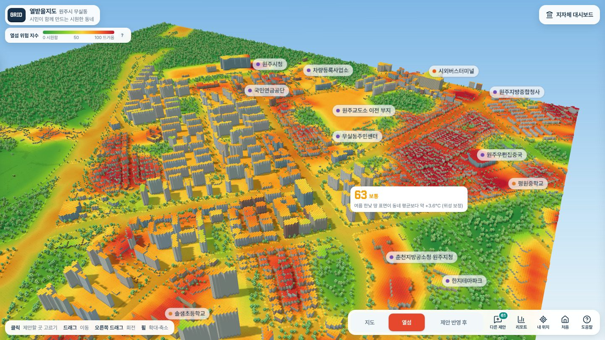
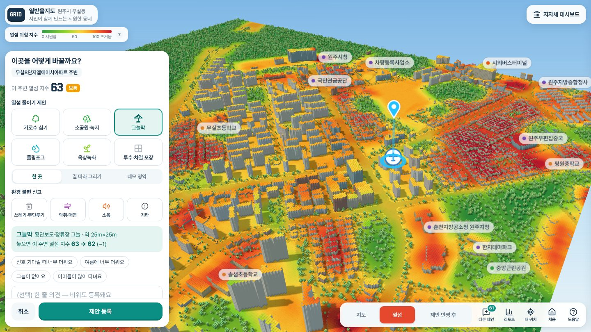
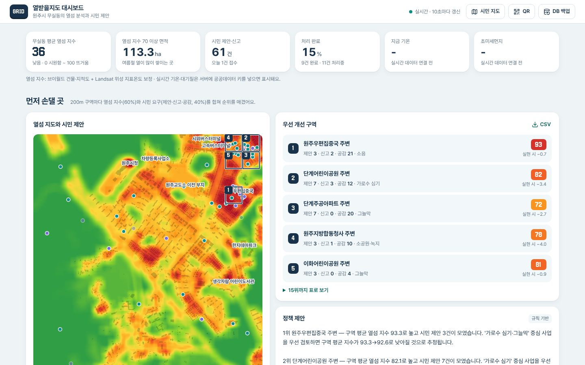
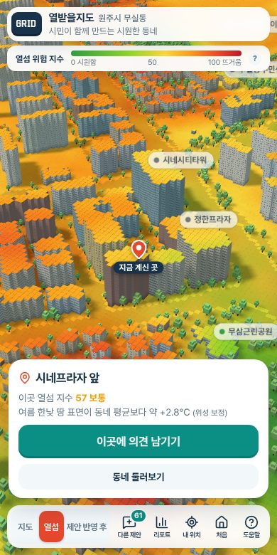

# 열받을지도 — 내 골목 열섬을 보고, 시민이 직접 식히는 3D 지도

팀 GRID · 2026 동북권 개발자 대상 오픈소스 아이디어 경진대회 7팀 · 주제 05-03 지역 환경데이터 분석 및 시각화 · [MIT 라이선스](LICENSE)

**시민 지도** https://grid-team7.duckdns.org/ · **지자체 대시보드** https://grid-team7.duckdns.org/admin/



원주시 무실동을 5m 블록 3D 지도로 만들고, 칸마다 **골목 단위 열섬 위험 지수**를 보여줍니다.
시민은 거리의 QR로 들어와 내가 선 자리의 열을 보고, 그 자리에 **가로수·그늘막·쿨링포그·옥상녹화** 같은 블록을 놓아 제안합니다.
놓기 전에 지수가 얼마나 내려갈지 먼저 보여주고, 모인 제안은 지자체 대시보드에서 **열섬 데이터와 합쳐 어디부터 개선할지 순위**가 됩니다.

## 무엇을 하나요

| 시민 지도 | 지자체 대시보드 |
| --- | --- |
|  |  |

**시민 지도** (`web/`, 앱 설치 없이 폰·PC 브라우저)
- 3D 복셀 지도 + 5m 칸마다 열섬 위험 지수 (0 시원함 ~ 100 뜨거움), 실시간 기온·초미세먼지
- 개선 블록 6종(가로수·소공원·그늘막·쿨링포그·옥상녹화·투수 포장)을 한 곳·길·네모로 놓기, 놓기 전 효과 미리보기
- '제안 반영 후': 시민 제안이 모두 실현되면 지도가 서서히 식어 가고, 결과 카드에 영향권 지수 전→후·시원해진 면적·가장 많이 식은 곳(°C)과 환경 불편 신고 현황을 함께 표시
- '▶ 제안 재생': 시민 의견이 올라온 순서대로 지도에 놓이며 동네가 식어 가는 타임랩스
- 환경 불편 신고, 다른 시민 제안 보기·공감, 내 제안의 처리 상태·담당자 답변 확인
- 거리 QR 모드: QR을 찍으면 그 자리로 바로 이동 (`?at=위도,경도&name=장소`), 처음 쓰는 사람을 위한 화면 둘러보기
- 지도 보기: 큰길 중앙선·가장자리선, 멀리서는 중요한 곳만 보이는 이름표

**지자체 대시보드** (`web/admin/`)
- 우선 개선 구역 TOP 5: 200m 구역마다 열섬 지수 60% + 시민 요구 40%, 제안 실현 시 지수 변화
- AI 정책 제안(Amazon Bedrock, 수치 자료만 근거로 작성, 실패 시 규칙 기반), 열섬 × 시민 요구 산점도, 유형별 통계
- 열섬 지수의 근거: Landsat 위성 표면온도와 비교 (100m 구역 상관 0.88)
- 민원 목록(열마다 정렬), 처리 상태·답변·숨기기, 장난·부적절 제안 거르기, CSV, DB 백업



## 열섬 지수는 어떻게 계산하나요

5m 칸마다 주변 50m 안의 건물 지붕·포장면·녹지·물 비율로 0~100점을 매깁니다. 가중치는 Landsat 8·9 여름 표면온도 5장면(2023~2025)에 맞춰 보정했고,
100m 구역 기준 상관계수 0.88, 지수 10점 차이 ≈ 여름 한낮 땅 표면 약 1.3°C입니다. 기온이 아니라 **땅 표면 온도 기준 추정치**입니다.
자세한 내용과 재현 방법: [docs/HEAT.md](docs/HEAT.md)

## 구조

```
시민 폰·PC ──QR/주소──▶ web/ (Three.js 3D 지도, 빌드 도구 없음)
                            │ POST /api/complaints
                            ▼
                     backend/ (FastAPI + SQLite + Amazon Bedrock)
                            │ GET /api/priority, /api/stats, /api/ai/policy …
                            ▼
                     web/admin/ (지자체 대시보드, ECharts)

data/ : 브이월드 SHP → web/data/voxels.json, labels.json (미리 한 번 변환)
        Landsat 표면온도 → 열섬 지수 보정 (calibrate_lst.py, export_lst.py)
서버  : AWS EC2 (Ubuntu) + nginx(HTTPS) + systemd  → deploy/
```

## 로컬에서 실행 (5분)

Python 3.10 이상.

```bash
git clone https://github.com/patrickswawa-coder/GRID.git
cd GRID
python -m venv .venv
# Mac/Linux: source .venv/bin/activate     Windows: .venv\Scripts\activate
pip install -r backend/requirements.txt

cd backend
# Mac/Linux
SERVE_WEB=1 AI_ENABLED=0 POST_INTERVAL=0 uvicorn main:app --reload --port 8000
# Windows PowerShell
$env:SERVE_WEB="1"; $env:AI_ENABLED="0"; $env:POST_INTERVAL="0"; uvicorn main:app --reload --port 8000
```

- 시민 지도 http://localhost:8000 · 지자체 대시보드 http://localhost:8000/admin/
- 관리자 기능(처리 상태·답변·삭제·백업)은 `.env`의 `ADMIN_PASSWORD`로 로그인 (`.env.example` 참고)
- 예시 제안 넣기: `python data/seed_complaints.py --n 80` (다른 터미널, 레포 맨 위 폴더에서)
- 테스트: `cd backend && python -m pytest -q`
- AI를 켜려면 AWS 자격 증명이 있는 곳에서 `AI_ENABLED=1` (`MODEL_ID`로 모델 지정)

## 다른 동네에 적용하기

코드에는 무실동만의 내용이 없습니다. 공공데이터만 바꿔 넣으면 같은 지도와 대시보드가 만들어집니다.

1. 국가공간정보포털·브이월드에서 그 지역의 **GIS건물통합정보**와 **연속지적도** SHP를 받아 `data/raw/`에 넣습니다.
2. `data/build_voxels.py`의 `DEFAULT_BBOX`(서·남·동·북 경위도)를 그 동네 범위로 바꿉니다.
3. 데이터 도구 설치 후 변환합니다.
   ```bash
   pip install -r data/requirements.txt
   python data/clip_buildings.py "data/raw/AL_D010_*.shp"   # 범위만 잘라 합치기
   python data/clip_parcels.py "data/raw/AL_D002_*.shp"
   python data/build_voxels.py --buildings data/raw/muksil_buildings.gpkg --parcels data/raw/muksil_parcels.gpkg --name "OO시 OO동"
   python data/build_labels.py --buildings data/raw/muksil_buildings.gpkg
   ```
4. (선택) 그 지역 위성 표면온도로 가중치 보정: `python data/fetch_lst.py && python data/calibrate_lst.py` ([docs/HEAT.md](docs/HEAT.md))
5. (선택) 거리 QR 장소를 `data/qr_spots.csv`에 적고 포스터 만들기: `python data/make_qr.py https://서버주소/ --spots data/qr_spots.csv`

화면 문구 일부(리포트·대시보드 제목의 '무실동')는 아직 직접 바꿔야 합니다.

## 서버 배포

[deploy/README.md](deploy/README.md) 참고. 요약: 서버에서 `cd ~/GRID && git pull --ff-only && ./deploy.sh`. HTTPS는 `deploy/enable_https.sh`.

## 문서

- 열섬 지수 계산법·위성 보정·한계: [docs/HEAT.md](docs/HEAT.md)
- 데이터 형식·좌표계·API: [docs/CONVENTIONS.md](docs/CONVENTIONS.md)
- 서버 배포·HTTPS: [deploy/README.md](deploy/README.md)
- 거리 QR 포스터: [docs/qr/](docs/qr/)

## 폴더

| 폴더 | 내용 |
| --- | --- |
| `web/` | 시민 3D 지도 (`js/` 지도·열섬·도로·이름표·연출, `data/` 변환된 지도), `web/admin/` 지자체 대시보드, `web/vendor/` three.js·ECharts·글꼴 |
| `backend/` | FastAPI 서버 (`main.py` 민원 API, `heatmodel.py` 열섬·우선순위, `envdata.py` 실시간 대기·기상, `moderation.py` 부적절 민원 거르기), `tests/` |
| `data/` | 공공데이터 → 3D 지도 변환, 위성 표면온도 받기·보정, 예시 민원, QR 만들기 |
| `deploy/` | 서버 설정·HTTPS 스크립트 (`deploy.sh`는 맨 위 폴더) |

## 라이선스

코드는 [MIT](LICENSE)입니다. 함께 쓰는 오픈소스(three.js, ECharts, Pretendard, Galmuri, Lucide 등)와 공공데이터 출처는 [THIRD_PARTY_NOTICES.md](THIRD_PARTY_NOTICES.md)에 정리했습니다.
